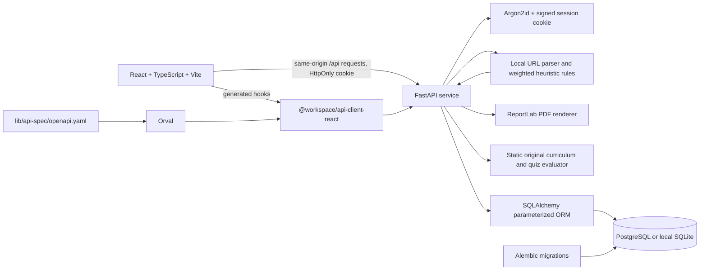

# Architecture and data model

## Component map



The frontend never sends an analysis request to the submitted destination. It sends the URL string to CyberShield's API, where the URL is validated, normalized, checked against deterministic rules, redacted, and stored. The analyzer has no HTTP client, DNS resolver, crawler, or browser automation dependency.

## Workspace map

- `artifacts/cybershield/src/` — React routes and UI.
- `artifacts/api-server/cybershield_api/` — FastAPI application, request schemas, SQLAlchemy models, analysis logic, session security, and route modules.
- `artifacts/api-server/migrations/` — Alembic's versioned schema changes.
- `artifacts/api-server/tests/` — isolated SQLite-backed unit/API tests.
- `lib/api-spec/openapi.yaml` — source contract for request/response shapes.
- `lib/api-client-react/src/generated/` — generated client; regenerate instead of hand-editing.

## Data model

### `users`

| Field | Purpose |
| --- | --- |
| `id` | Internal primary key |
| `email` | Normalized unique login identifier |
| `display_name` | User-selected display label |
| `password_hash` | Argon2id encoded hash; never the original password |
| `created_at` | UTC account creation timestamp |

### `analyses`

| Field | Purpose |
| --- | --- |
| `id` | Internal primary key |
| `user_id` | Owner foreign key; cascade deletion |
| `submitted_url` | Sanitized display form; sensitive query values/fragments removed |
| `normalized_url` | Lowercase/IDNA normalized HTTP(S) URL used for findings |
| `score`, `category` | Final capped score and risk band |
| `findings_json` | Structured rule IDs, explanations, severities, and point weights |
| `recommendation` | Plain-language next step based on the score |
| `created_at` | UTC scan timestamp |

### `learning_progress`

| Field | Purpose |
| --- | --- |
| `id` | Internal primary key |
| `user_id` | Owner foreign key; cascade deletion |
| `lesson_slug` | One of the six stable module identifiers |
| `best_score` | Best percentage score submitted for the quiz |
| `completed`, `completed_at` | Completion after reaching 70% |
| `updated_at` | Last saved quiz attempt |

Unique `(user_id, lesson_slug)` prevents duplicate progress records. Quiz correctness is stored in source curriculum definitions, not exposed to the browser before submission.

## Authentication and request protections

- Passwords use Argon2id with an intentionally non-trivial memory and time cost.
- A signed session cookie holds only an internal integer user ID. It is HttpOnly, SameSite=Lax, and secure in production. It is not returned to frontend JavaScript.
- State-changing browser requests are restricted to the same request host or a specifically allowed `CORS_ORIGINS` value; cross-site fetch metadata is rejected when an Origin header is absent.
- All analysis, report, learning-progress, and settings reads require a valid session. Records are queried with both the row ID and authenticated owner ID.
- ORM values are bound as SQL parameters. No submitted URL is interpolated into SQL.
- API request bodies are capped at 16 KiB, including chunked bodies.
- Auth endpoints are limited per client address; analyses are limited per account. Current limits are process-local and should move to a shared store for multi-worker production.
- Error responses are deliberately generic and do not echo malformed input, passwords, cookies, or database connection details.

## API contract and generated client

Edit `lib/api-spec/openapi.yaml`, then run:

```sh
pnpm --filter @workspace/api-spec run codegen
```

Generated React Query hooks live in `lib/api-client-react`. The API's live interactive reference is `/api/docs`. See [API endpoints](api-reference.md).

## Persistence and migrations

`DATABASE_URL` selects PostgreSQL; `postgres://` and `postgresql://` are normalized to the psycopg 3 SQLAlchemy dialect. If unset, local development uses an ignored SQLite file. Tests create isolated in-memory SQLite databases.

Apply schema changes explicitly:

```sh
uv run --directory artifacts/api-server alembic upgrade head
```

Do not rely on `create_all()` or startup-time DDL in deployed environments. Review and apply migrations to the intended database before the API serves new code.
